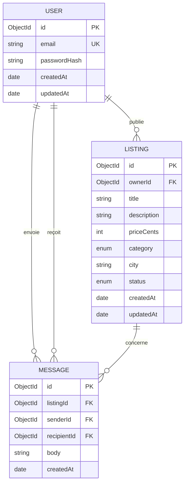

# Data Model: Occaz

Collections MongoDB gérées par Mongoose. Les règles de validation métier sont appliquées par
Zod à l'entrée (cf. [research.md §2](./research.md)) ; Mongoose ne garde que les contraintes
structurelles (types, `required`, `enum`, index).

Sérialisation commune (`toJSON`) : `_id` → `id` (string), suppression de `__v` et de
`passwordHash`. Les dates sortent en ISO 8601.

## MCD (entités et associations)



Cardinalités :

- **publie** : un USER publie 0,n LISTING ; un LISTING est publié par 1,1 USER.
- **envoie / reçoit** (P3) : un USER envoie 0,n MESSAGE et en reçoit 0,n ; un MESSAGE a
  exactement 1 expéditeur et 1 destinataire.
- **concerne** (P3) : un LISTING concerne 0,n MESSAGE ; un MESSAGE concerne 1,1 LISTING.

## MLD

Clé primaire **en gras**, clé étrangère précédée de `#`.

- USER (**id**, email, passwordHash, createdAt, updatedAt)
- LISTING (**id**, title, description, priceCents, category, city, status, createdAt, updatedAt, #ownerId)
- MESSAGE (**id**, body, createdAt, #listingId, #senderId, #recipientId) — P3

Choix de modélisation :

- **Catégorie et statut** sont des listes fermées (`enum`), pas des tables : elles ne changent
  pas à l'exécution et n'ont aucun attribut propre.
- **MongoDB n'a pas de clés étrangères** : `ownerId`, `listingId`, etc. sont des ObjectId de
  référence. L'intégrité (le propriétaire existe, l'annonce existe) est garantie par les
  services, pas par la base.
- **Références plutôt qu'imbrication** : les annonces ne sont pas imbriquées dans le document
  utilisateur, car elles sont lues et filtrées seules (« Mes annonces », vitrine publique).

## User (`users`)

| Champ | Type | Règles |
|---|---|---|
| `_id` | ObjectId | généré |
| `email` | string | requis, `trim` + `lowercase`, format email, **index unique** |
| `passwordHash` | string | requis, bcrypt coût 10, jamais renvoyé |
| `createdAt`, `updatedAt` | Date | `timestamps: true` |

Entrées (Zod) : `email` email valide ; `password` string ≥ 8 caractères. Corps strict.

Représentation publique : `{ "id", "email" }`.

Doublon : l'email est normalisé en minuscules avant insertion ; l'erreur Mongo `11000`
est traduite en `409 EMAIL_ALREADY_USED`.

## Listing (`listings`)

| Champ | Type | Règles |
|---|---|---|
| `_id` | ObjectId | généré, jamais fourni par le client |
| `ownerId` | ObjectId → User | requis, posé depuis le JWT, jamais fourni ni modifiable |
| `title` | string | après `trim` : 1 à 120 caractères |
| `description` | string | 0 à 2000 caractères, défaut `""` |
| `priceCents` | number | entier, 1 ≤ x ≤ `Number.MAX_SAFE_INTEGER` |
| `category` | enum | `vehicules` \| `immobilier` \| `multimedia` \| `maison` \| `mode` \| `loisirs` \| `autre` |
| `city` | string | après `trim` : 1 à 80 caractères |
| `status` | enum | `available` \| `sold`, défaut `available` |
| `createdAt`, `updatedAt` | Date | `timestamps: true` |

Index : `{ ownerId: 1, createdAt: -1 }` (Mes annonces) ; `{ status: 1, createdAt: -1 }` (P2).

Entrées (Zod) :

- **create** : `title`, `priceCents`, `category`, `city` requis ; `description`, `status`
  facultatifs. `.strict()` → `id`, `ownerId`, `_id` ou tout autre champ = 400.
- **update** : `create.partial().strict()` + au moins une clé.

Transitions de statut : `available ⇄ sold`, librement par le propriétaire via `PATCH`.
Une annonce `sold` disparaît de la vitrine publique mais reste dans « Mes annonces ».

Représentation (privée et publique) :

```json
{ "id", "ownerId", "title", "description", "priceCents", "category", "city", "status",
  "createdAt", "updatedAt" }
```

`ownerId` est un identifiant opaque, pas une donnée personnelle (FR-015) ; il permet au front
de masquer « Contacter » sur ses propres annonces (P3).

Règle d'accès (gestion privée) : toute lecture/écriture filtre sur `{ _id: id, ownerId: userId }`.
Aucun résultat → `404 NOT_FOUND`, que l'annonce n'existe pas ou appartienne à un autre compte.

## Message (`messages`) — P3 uniquement

| Champ | Type | Règles |
|---|---|---|
| `_id` | ObjectId | généré |
| `listingId` | ObjectId → Listing | requis |
| `senderId` | ObjectId → User | depuis le JWT |
| `recipientId` | ObjectId → User | = `ownerId` de l'annonce, calculé serveur |
| `body` | string | après `trim` : 1 à 1000 caractères |
| `createdAt` | Date | `timestamps: true` |

Règles : annonce `available` requise ; `senderId ≠ recipientId` (sinon 400) ; lecture limitée
à `recipientId = userId` ou `senderId = userId`.
