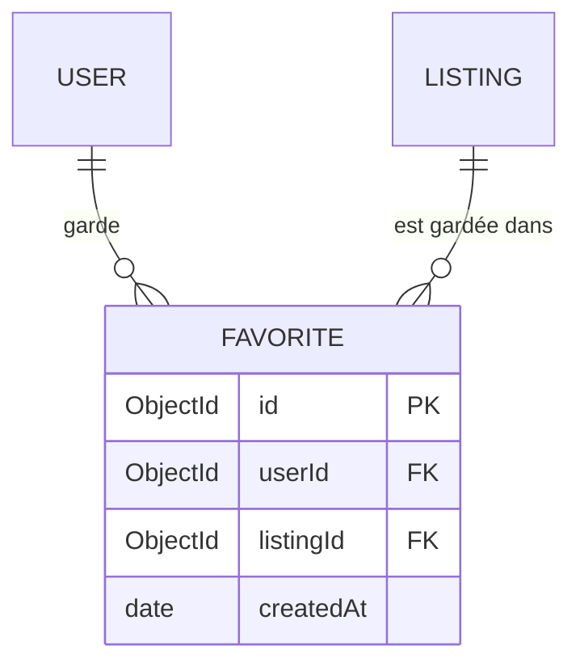

# Data Model: Favoris

Complète le modèle du MVP ([001 data-model](../001-marketplace-mvp/data-model.md)).

## MCD



- Un USER garde 0 à 200 FAVORITE ; un FAVORITE appartient à 1,1 USER.
- Une LISTING est gardée dans 0 à n FAVORITE ; un FAVORITE concerne 1,1 LISTING.

## MLD

- FAVORITE (**id**, createdAt, #userId, #listingId), avec (#userId, #listingId) unique.

## Favorite (`favorites`)

| Champ | Type | Règles |
|---|---|---|
| `_id` | ObjectId | généré |
| `userId` | ObjectId → User | requis, posé depuis le JWT, jamais fourni par le client |
| `listingId` | ObjectId → Listing | requis, 24 caractères hexadécimaux |
| `createdAt` | Date | `timestamps: { createdAt: true, updatedAt: false }` |

Index :

- `{ userId: 1, listingId: 1 }` **unique** : pas de doublon (FR-002) ;
- `{ userId: 1, createdAt: -1 }` : liste triée par date d'ajout (FR-004) ;
- `{ listingId: 1 }` : suppression des favoris d'une annonce supprimée (FR-005).

## Règles

- **Ajout** autorisé seulement si l'annonce existe, est `available` et `ownerId ≠ userId`, et si le compte
  a moins de 200 favoris.
- **Lecture / retrait** : toujours filtrés sur `userId = req.userId`.
- **Suppression d'une annonce** : supprime ses favoris.
- **Annonce passée `sold`** : le favori reste ; il est renvoyé avec `status: "sold"`.
- **Annonce remise `available`** : rien à faire, le favori redevient « disponible ».

## Représentation (`GET /api/favorites`)

```json
{ "items": [
  { "id": "<listingId>", "ownerId", "title", "description", "priceCents", "category", "city",
    "status": "available" | "sold", "createdAt", "updatedAt", "favoritedAt" }
] }
```

`id` est celui de l'**annonce** (le front adresse les favoris par annonce) ; l'id interne du favori n'est
jamais exposé.

## Navigateur (visiteur)

`localStorage["occaz.favorites"]` : tableau JSON d'ids d'annonces (inchangé) ; importé puis vidé à la
connexion.
