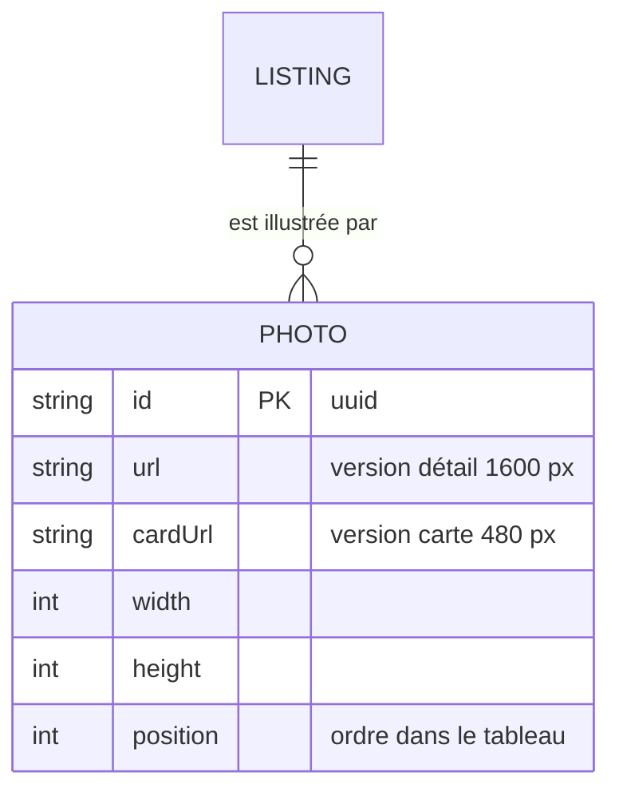

# Data Model: Photos des annonces

Complète `Listing` ([001 data-model](../001-marketplace-mvp/data-model.md)).

## MCD



- Une LISTING est illustrée par 0 à 5 PHOTO ; une PHOTO appartient à 1,1 LISTING.

## MLD

- PHOTO (**id**, url, cardUrl, width, height, position, #listingId), imbriquée dans LISTING
  (`listings.photos[]`) : la position est l'indice dans le tableau.

## Champ `photos` de `Listing`

| Champ | Type | Règles |
|---|---|---|
| `photos` | tableau | 0 à 5 éléments, défaut `[]` ; indice 0 = photo principale |
| `photos[].id` | string | `crypto.randomUUID()`, généré serveur |
| `photos[].url` | string | `/uploads/<uuid>-1600.webp` |
| `photos[].cardUrl` | string | `/uploads/<uuid>-480.webp` |
| `photos[].width`, `height` | number | dimensions de la version détail |

Sous-schéma Mongoose sans `_id` propre (`_id: false`), l'`id` étant l'uuid.

## Règles de validation (serveur)

- Fichier : signature JPEG, PNG ou WebP ; ≤ 5 Mo ; ≤ 40 mégapixels.
- Nombre : `photos.length + nouvelles ≤ 5`.
- Ordre (`PATCH`) : `order` est une permutation exacte des ids existants (même taille, mêmes ids,
  sans doublon), sinon 400.
- `photoId` : uuid valide, sinon 400 ; inconnu sur cette annonce → 404.
- Toutes les opérations : annonce filtrée sur `{ _id, ownerId }`, sinon 404.

## Fichiers

- `UPLOADS_DIR/<uuid>-1600.webp` et `UPLOADS_DIR/<uuid>-480.webp`, WebP qualité 80, sans métadonnées.
- Supprimés avec la photo ou avec l'annonce.

## Représentation

Les réponses d'annonce (privées et publiques) incluent :

```json
"photos": [ { "id": "6f1c…", "url": "/uploads/6f1c…-1600.webp", "cardUrl": "/uploads/6f1c…-480.webp", "width": 1600, "height": 1200 } ]
```

Une annonce sans photo renvoie `"photos": []`.
