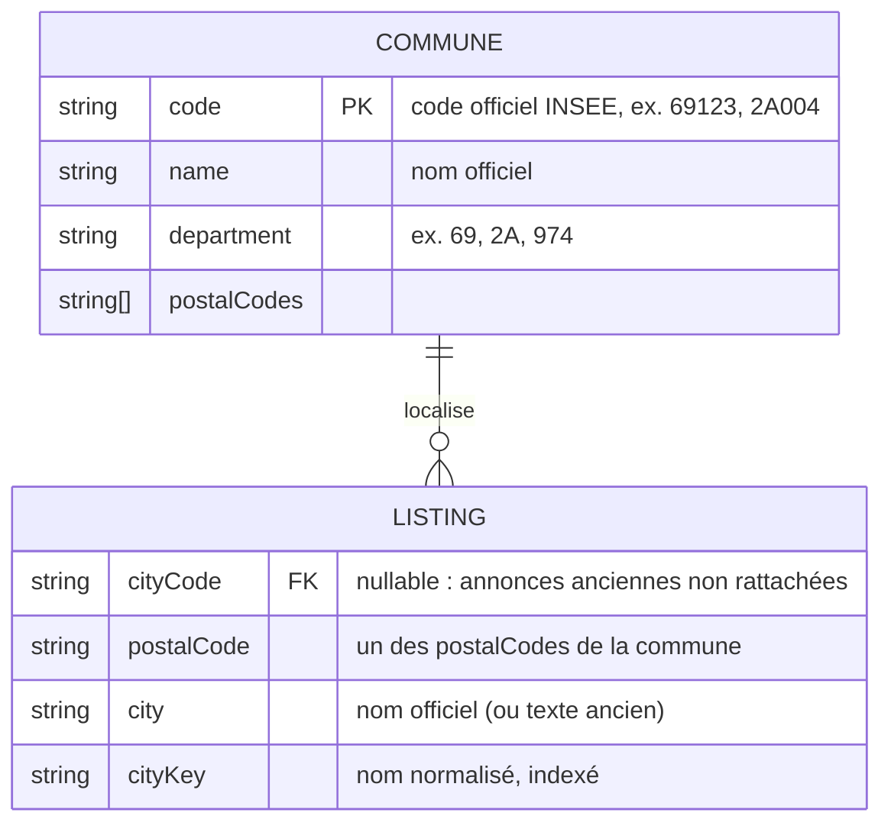

# Data Model: Communes fiables

## MCD



- Une COMMUNE localise 0 à n LISTING ; une LISTING est localisée par 0 ou 1 COMMUNE (0 seulement pour les
  annonces anciennes non rattachées).

## MLD

- COMMUNE (**code**, name, department, postalCodes) — référentiel en lecture seule, fichier JSON.
- LISTING (…, city, cityKey, #cityCode, postalCode).

## Référentiel `backend/data/communes.json`

```json
{ "source": "geo.api.gouv.fr/communes", "fetchedAt": "2026-10-28",
  "communes": [ ["69123", "Lyon", "69", ["69001", "69002", "…"]], … ] }
```

Chargé une fois en mémoire ; index : `code → commune`, `nom normalisé → [communes]`, `code postal →
[communes]`. Les 5 communes sans code postal sont ignorées.

## Champs ajoutés à `Listing`

| Champ | Type | Règles |
|---|---|---|
| `cityCode` | string \| null | 5 caractères ; doit exister dans le référentiel ; requis à la création et à toute modification d'une annonce non rattachée |
| `postalCode` | string \| null | 5 chiffres ; doit appartenir à `cityCode` |
| `city` | string | **calculé serveur** = nom officiel ; texte d'origine pour les anciennes annonces |
| `cityKey` | string | `normalize(city)`, index `{ status: 1, cityKey: 1, createdAt: -1 }` |

Entrée API (Zod strict) : `cityCode` + `postalCode` ensemble ; `city` et `cityKey` interdits.

## Normalisation

`normalize("Saint-Étienne") === "saint etienne"` (minuscules, sans accents, tirets/apostrophes → espace).

## Représentation

```json
{ "id": "…", "city": "Lyon", "cityCode": "69123", "postalCode": "69003", … }
```

Annonce ancienne non rattachée : `"city": "Lyonnn", "cityCode": null, "postalCode": null`.
