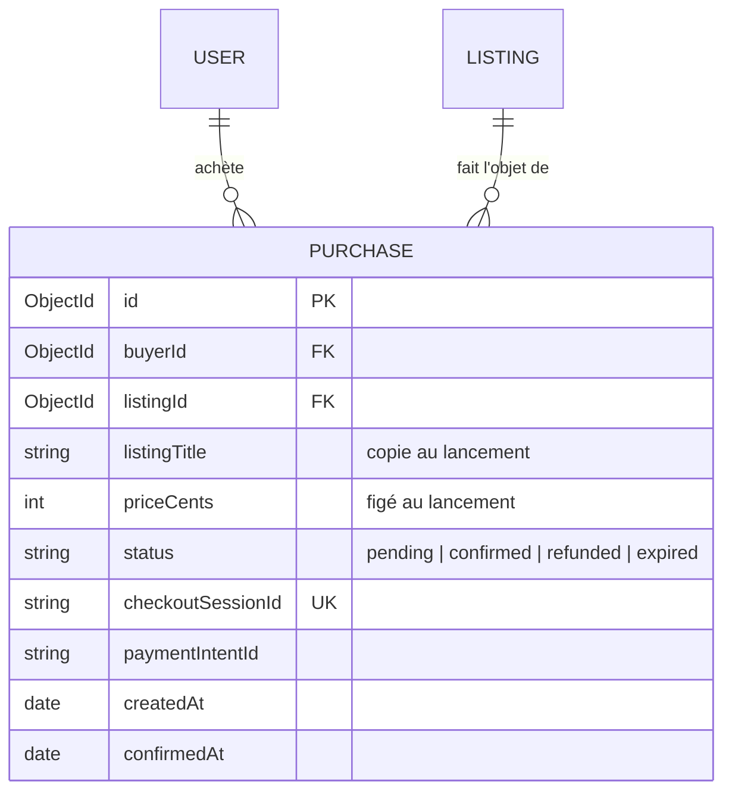

# Data Model: Paiement de démonstration

## MCD



- Un USER achète 0 à n PURCHASE ; une PURCHASE a 1,1 acheteur.
- Une LISTING fait l'objet de 0 à n PURCHASE, dont **au plus une** `confirmed`.

## MLD

- PURCHASE (**id**, listingTitle, priceCents, status, checkoutSessionId, paymentIntentId, createdAt,
  confirmedAt, #buyerId, #listingId).
- LISTING (…, soldOnline { at, priceCents, #purchaseId }).

## Purchase (`purchases`)

| Champ | Type | Règles |
|---|---|---|
| `buyerId` | ObjectId | depuis le JWT |
| `listingId` | ObjectId | annonce disponible, pas celle de l'acheteur |
| `listingTitle` | string | copie (l'annonce peut être supprimée ensuite) |
| `priceCents` | number | lu en base au lancement, jamais fourni par le client |
| `status` | enum | `pending` → `confirmed` \| `refunded` \| `expired` |
| `checkoutSessionId` | string | unique, index |
| `paymentIntentId` | string \| null | renseigné à la confirmation |
| `confirmedAt` | Date \| null | |

Index : `{ buyerId: 1, createdAt: -1 }` (Mes achats), `{ checkoutSessionId: 1 }` unique,
`{ buyerId: 1, listingId: 1, status: 1 }` (réutiliser une session en attente).

## Transitions

```text
pending ──completed + annonce encore disponible──▶ confirmed   (annonce → sold + soldOnline)
pending ──completed + annonce plus disponible────▶ refunded    (remboursement Stripe)
pending ──session expirée───────────────────────▶ expired
```

États finaux : aucun retour arrière ; un événement rejoué sur un état final est ignoré.

## Ajout à `Listing`

| Champ | Type | Règles |
|---|---|---|
| `soldOnline` | objet \| absent | `{ at: Date, priceCents, purchaseId }` ; visible du **propriétaire** uniquement ; une annonce `soldOnline` ne peut pas repasser `available` |

Jamais d'email ni d'id de l'acheteur dans les réponses au vendeur.

## Représentation (`GET /api/purchases`)

```json
{ "items": [ { "id", "listingId", "listingTitle", "priceCents", "status", "createdAt", "confirmedAt" } ] }
```
